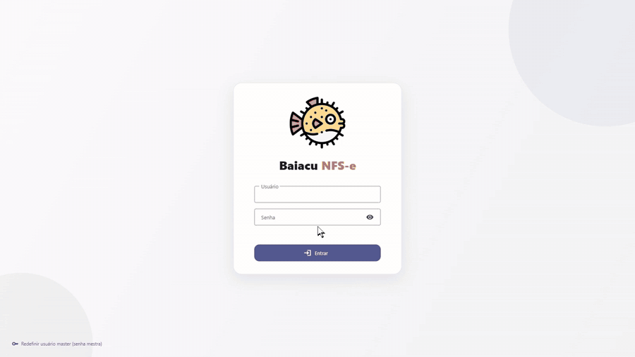
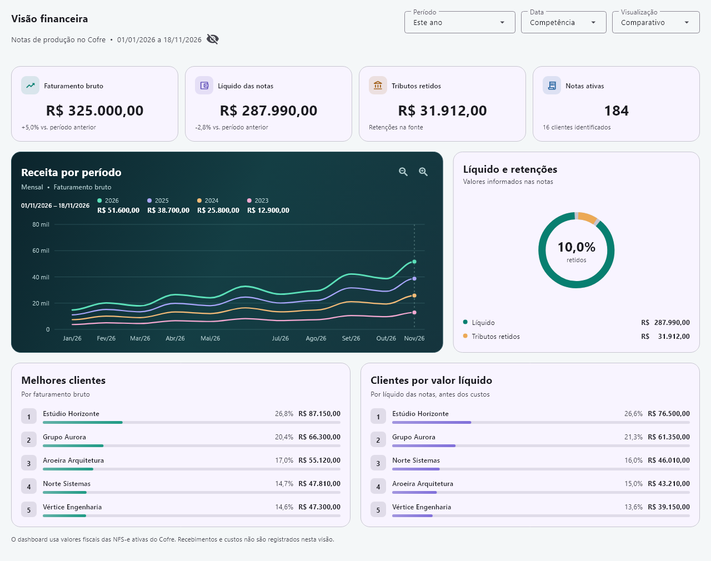
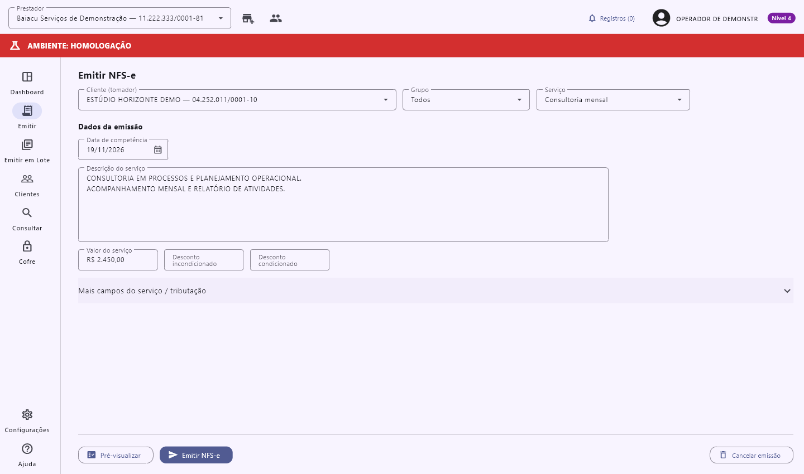
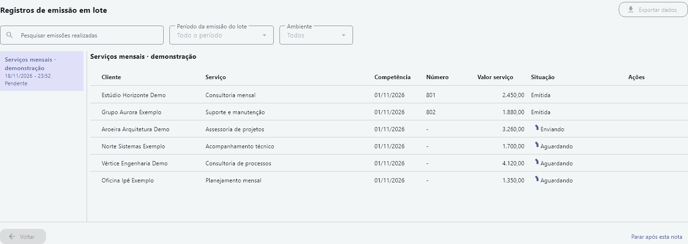
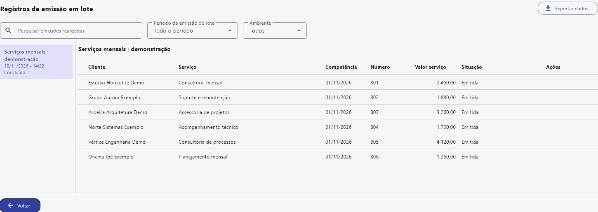
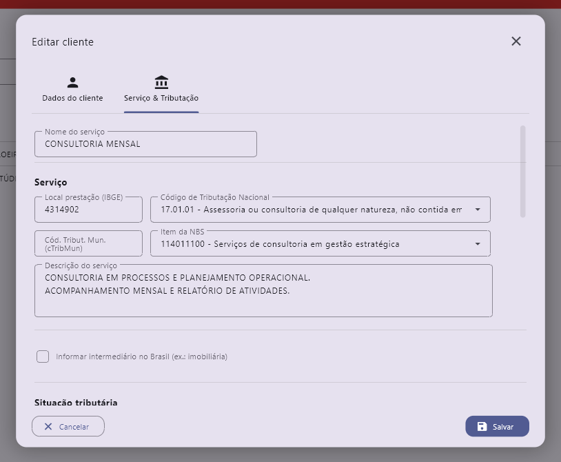
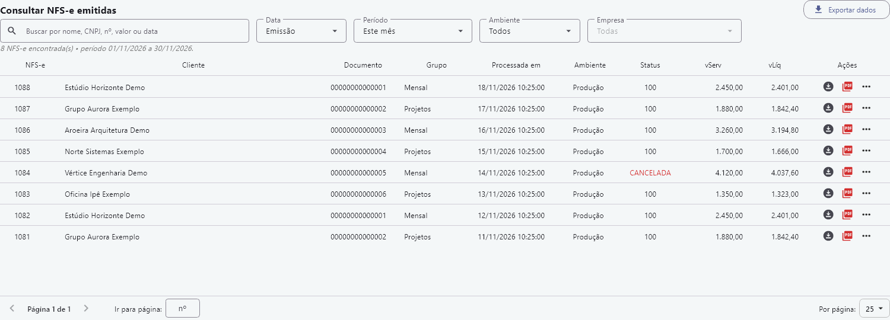

  

  
  &nbsp;
  

  

  <b>Emita, envie e guarde as notas fiscais de serviço da sua empresa sem complicação.</b> 
  Você cadastra seus clientes uma vez e, a partir daí, cada nota sai em segundos e chega no e-mail do cliente na hora.

---

## 💡 Por que usar

Emitir NFS-e não precisa ser uma tarefa chata. Com o **Baiacu NFS-e**, você não redigita os dados do cliente nem do serviço a cada nota, e não precisa ficar guardando PDF e XML em pastas espalhadas.

O programa já sabe quem é o cliente, qual serviço você presta para ele e como ele é tributado. Ele também **confere a nota antes de enviar**, para você não descobrir o erro depois.

É **gratuito**, roda no **seu computador** e já está pronto para a **Reforma Tributária**.

---

## 🚀 Como funciona

  

---

## ✨ Tudo o que ele faz

> As novas capturas usam dados fictícios e mostram a revisão local sobre a versão 1.0.0.5. O botão de download abre a distribuição publicada no GitHub.

  

### 📈 Dashboard de análise

- Veja faturamento bruto, líquido das notas, tributos retidos e a participação de cada cliente no total do período.
- Filtre por emissão ou competência. Em **Comparativo**, veja o faturamento bruto do recorte selecionado e dos mesmos dias ou meses nos três anos anteriores. Por exemplo, **Este mês** compara o mesmo mês de cada ano até a data de referência.
- Passe o mouse para consultar um ponto e use a roda ou as lupas para ampliar. Os valores começam ocultos. O olho ao lado de **Visão financeira** revela ou oculta os números.
- Os indicadores usam as NFS-e ativas de produção do Cofre para o prestador selecionado. Recebimentos efetivos, despesas e lucro dependem de registros próprios.

### 🧾 Emitir notas sem dor de cabeça
- **Escolha o cliente e o serviço.** Descrição, valor e tributos já vêm do cadastro; você só ajusta o que mudou.
- **Veja a nota antes de mandar.** Uma prévia mostra tudo em cartões fáceis de ler: quem presta, quem recebe, o serviço, os valores e os impostos.
- **O programa confere por você.** Antes de transmitir, ele verifica a nota e avisa o que precisa ser corrigido.
- **Códigos do IBS/CBS que combinam.** No cadastro do serviço, o indicador da operação (cIndOp), o CST e a classificação tributária (cClassTrib) aparecem filtrados pelo NBS escolhido, conforme a tabela oficial de correlação (Anexo VIII da NFS-e); a tributação integral (CST 000) aparece sempre. A prévia e o lote avisam das combinações que costumam ser recusadas, e as tabelas podem ser atualizadas com um clique.
- **Caiu a internet?** A nota fica guardada numa fila e você envia depois, sem perder nada e sem refazer.
- **Errou?** Cancele ou substitua a nota pelo próprio programa.

- **Escolha a data de competência** no calendário. A data de hoje vem preenchida.

### 📦 Emitir em lote

- Salve um modelo por prestador e marque serviços de vários clientes de uma vez.
- Confirme o envio e acompanhe a situação de cada nota. O histórico permite corrigir pendências, retransmitir e consultar o número das notas emitidas.
- Exporte o histórico em PDF, Excel ou CSV, com opção de incluir XMLs e DANFSe disponíveis no Cofre.
- Use o ícone **Importar/exportar lote** para transferir os modelos em JSON.

<b>Ver o lote após a conclusão</b>

### 📇 Clientes e serviços organizados
- Cadastre cada cliente **uma única vez**, junto com os serviços que você presta para ele.
- **Busque o CNPJ e o CEP** pela internet para não digitar endereço na mão.
- Separe os clientes em **grupos** para achar todo mundo rápido.
- **Importe e exporte clientes por planilha** (Excel, OpenDocument ou CSV). Baixe o modelo, preencha e veja uma prévia com os erros de cada linha antes de gravar. O CPF/CNPJ evita duplicados, e o município pode vir pelo código IBGE ou pela cidade e UF.
- Já aceita o **novo CNPJ com letras e números**.

### 🏢 Uma empresa ou várias
- Ideal para **contadores e escritórios**: cadastre vários prestadores, cada um com o próprio certificado digital, numeração e e-mail.
- Troque de empresa em um clique, sem misturar nada.

### 🗄️ Cofre de notas
- Traz do **Ambiente Nacional da NFS-e** todas as notas em que a sua empresa aparece: as que você **emitiu** e as que outras empresas emitiram **para você**.
- Procure qualquer nota por cliente, número, valor ou período. Em **Consultar** e no **Cofre**, escolha **Emissão** ou **Competência** para filtrar e exportar por essa data.
- Gere o **PDF da nota (DANFSe)** quando quiser e baixe o **XML** a qualquer momento.
- Exporte para **Excel** ou para um **relatório em PDF**, pronto para mandar ao contador.

### ✉️ Envio por e-mail
- A nota vai para o cliente **com o PDF e o XML anexados**, saindo do **seu próprio e-mail**.
- Escreva a mensagem do seu jeito, com fontes, negrito e cores, e use campos automáticos, como o nome do cliente, o número da nota e o link de consulta.

### 🔒 Seguro e privado
- **Seus dados ficam no seu computador**, guardados num banco **cifrado**. Nada vai para servidores de terceiros; a nota segue só para o sistema nacional da NFS-e.
- Tudo é protegido por uma **senha mestra**. O certificado digital e as senhas ficam guardados cifrados, nunca soltos em pastas.
- Crie **usuários com níveis de acesso** diferentes para quem trabalha com você.
- Faça **backup** de tudo em um arquivo e restaure quando precisar.

### 📊 Pronto para a Reforma Tributária
- Já acompanha o leiaute da NFS-e com **IBS e CBS** e os prazos por operação e regime tributário. [Ato Conjunto RFB/CGIBS nº 7/2026](https://www.gov.br/nfse/pt-br/noticias/cgnfs-e-informa-ato-conjunto-rfb-cgibs-no-7-2026-atualiza-o-cronograma-de-obrigatoriedade-de-emissao-da-nfs-e-para-ibs-e-cbs/)
- Já traz as novas regras para **locação de imóveis**, com vencimento mensal calculado automaticamente.

### 🎨 Do seu jeito
- **Personalize as cores** do programa.
- **Leitor de PDF incluído**, para abrir as notas sem instalar mais nada.
- Um **histórico** registra tudo o que aconteceu, para você saber o que foi enviado e quando. Você define quanto espaço os logs podem ocupar e por quanto tempo ficam guardados, e pode **exportá-los para o suporte** com CPF, CNPJ e e-mail mascarados.
- **Sempre atualizado:** quando sai uma versão nova, o programa avisa e se atualiza com um clique, sem mexer nos seus dados. Você escolhe quando ele procura: ao abrir o programa, a cada hora, a cada 6 horas ou uma vez por dia.

---

## ✅ O que você precisa

| | |
|---|---|
| 💻 | Computador com **Windows 10 ou 11** |
| 🔑 | **Certificado digital A1** da empresa (arquivo `.pfx`) e a senha dele |
| 🏛️ | Município que aceite a **NFS-e pelo padrão nacional** |
| 🌐 | Internet para transmitir as notas |

---

## 🏁 Como começar

1. **Baixe** o instalador `Baiacu-NFS-e-…-setup.exe` em [Releases](https://github.com/williamlala/baiacu-nfse/releases/latest) e abra. Se aparecer a tela azul **"O Windows protegeu o computador"**, clique em **Mais informações** e depois em **Executar assim mesmo** (veja a pergunta frequente abaixo).
2. Avance as telas do instalador. Ele pede permissão de administrador **só nessa hora** e já deixa o programa pronto para **todos os usuários** do computador.
3. Crie a sua **senha mestra** e o seu usuário.
4. Cadastre a sua **empresa** e importe o **certificado digital**.
5. Faça uma nota no **ambiente de testes**, que não tem valor fiscal, para ver como tudo funciona.
6. Tudo certo? Mude para **produção** e comece a emitir. 🎉

Ficou alguma dúvida? O [**manual do usuário**](docs/Manual-Baiacu-NFS-e.pdf) explica cada tela, passo a passo.

---

## ❓ Perguntas frequentes

<b>Quanto custa?</b>

 
Nada. O Baiacu NFS-e é gratuito. Se ele facilitar o seu dia, você pode apoiar o projeto com uma doação em criptomoeda, mas é opcional.

<b>Meus dados vão para algum servidor?</b>

 
Não. Cadastros, notas, certificado e senhas ficam no seu computador, num banco cifrado. As notas são enviadas só para o sistema nacional da NFS-e, como em qualquer emissor.

<b>Posso testar sem emitir uma nota de verdade?</b>

 
Pode. O programa tem o ambiente de testes (homologação) do sistema nacional, onde as notas não têm valor fiscal. Quando estiver seguro, é só mudar para produção.

<b>Sou contador. Dá para cuidar de várias empresas?</b>

 
Dá. Cada empresa tem o próprio certificado, clientes, numeração e e-mail, e você troca entre elas em um clique.

<b>E se a internet cair na hora de emitir?</b>

 
A nota fica guardada numa fila de pendentes. Quando a conexão voltar, você envia de lá mesmo, sem refazer nada.

<b>Consigo ver as notas que outras empresas emitiram para mim?</b>

 
Sim. O Cofre de notas busca no Ambiente Nacional as notas emitidas para o seu CNPJ e guarda tudo junto com as que você emitiu.

<b>O Windows disse "O Windows protegeu o computador". É seguro?</b>

 
Esse aviso (SmartScreen) aparece para programas novos que ainda não têm um certificado de assinatura de código, que é pago. Não quer dizer que o arquivo tenha vírus. Confira se o instalador veio da página oficial de <a href="https://github.com/williamlala/baiacu-nfse/releases/latest">Releases</a>, clique em <b>Mais informações</b> e depois em <b>Executar assim mesmo</b>. Cada versão é enviada para análise da Microsoft, e o aviso tende a sumir conforme o programa ganha reputação.

<b>Como recebo as versões novas?</b>

 
O programa procura versão nova sozinho, na frequência que você escolher nas configurações.

<b>Várias pessoas usam o mesmo computador. Funciona?</b>

 
Funciona. O programa fica protegido, com bancos compartilhados cifrados. Desde a versão 1.0.0.3, o serviço **Baiacu NFSe - Dados** abre os bancos sob uma conta virtual própria.

<b>Funciona no Mac ou no Linux?</b>

 
Por enquanto, só no Windows 10 e 11.

---

## 🤝 Sobre o projeto e como contribuir

O Baiacu NFS-e é um projeto independente e voluntário. **Não há garantia de continuidade**: o programa é oferecido como está, e novas funcionalidades serão implementadas de acordo com a necessidade.

Quer sugerir um ajuste, pedir uma funcionalidade específica ou relatar um problema? Você pode:

- abrir um **chamado** em [Issues](https://github.com/williamlala/baiacu-nfse/issues). É só clicar em **New issue** e descrever o que você precisa (é preciso ter uma conta gratuita no GitHub);
- se você programa, enviar a sua alteração por um [**Pull Request**](https://github.com/williamlala/baiacu-nfse/pulls). Ela é revisada antes de entrar no programa (veja o [guia de contribuição](CONTRIBUTING.md));
- ou escrever direto para **[emissorbaiacu@gmail.com](mailto:emissorbaiacu@gmail.com)**

**Licença.** O código está aberto para leitura e para contribuições, mas não é software livre: você pode usar o programa à vontade (inclusive na empresa), conferir o código e propor melhorias por Pull Request. Não é permitido distribuir cópias nem publicar uma versão independente. Os detalhes estão na [licença](LICENSE.md).

---

## 💜 Apoie o projeto

O Baiacu NFS-e é feito com carinho e distribuído de graça, sem anúncios e sem mensalidade. Se ele economiza o seu tempo, considere uma doação em criptomoeda. Isso ajuda a manter o emissor em dia com as mudanças da NFS-e e da Reforma Tributária.

<table>
  <tr><th></th><th align="left">Moeda</th><th align="left">Rede</th><th align="left">Endereço</th></tr>
  <tr><td></td><td><b>Bitcoin</b> (BTC)</td><td>Bitcoin</td><td><code>bc1qs4r3fpdmahvcm6pxd2r7ctn077ndxzqgn8ntvd</code></td></tr>
  <tr><td></td><td><b>Tron</b> (TRX)</td><td>Tron</td><td><code>TV1YHohhftEayTmh1L63t5kCUqXgWt58K4</code></td></tr>
  <tr><td></td><td><b>Ethereum</b> (ETH)</td><td>Ethereum</td><td><code>0xaB91d332f687D03EA45537A8c0fB0BcfedDf0fB1</code></td></tr>
  <tr><td></td><td><b>Solana</b> (SOL)</td><td>Solana</td><td><code>CudVniUfVT5xtihXrDAa7wSr8m9wj416aeLTzD4MweKG</code></td></tr>
  <tr><td></td><td><b>BNB</b></td><td>BNB Smart Chain (BEP-20)</td><td><code>0xaB91d332f687D03EA45537A8c0fB0BcfedDf0fB1</code></td></tr>
</table>

> ⚠️ Envie cada moeda **somente pela rede indicada**. Uma rede diferente pode fazer a doação se perder.

© 2026 williamlala. Código-fonte disponível sob a [licença do Baiacu NFS-e](LICENSE.md). O programa inclui o leitor SumatraPDF (GPLv3), OpenSSL (Apache-2.0) e libxml2 (MIT). O leiaute da DANFSe é baseado no BrazilFiscalReport (LGPL-3.0).
